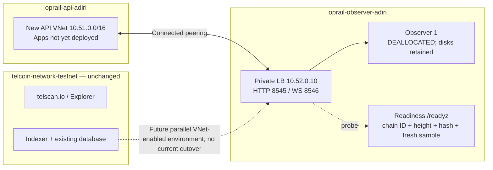

# Adiri observer pool and lifecycle operations

## Current state and application boundary

Observer 1 was migrated by **snapshot restore**, not an Azure resource move. Azure
rejected moving its original disks because they have incremental snapshots
(`UnsupportedMoveOfDiskWithIncrementalSnapshots`). The replacement passed the
independent reference height/hash check at block 516212 and a maintenance-mode
HTTP 503 test. It is deliberately **deallocated**, with chain data retained.

- Observer resource group: `oprail-observer-adiri`.
- API resource group: `oprail-api-adiri`; networking only, no applications deployed.
- Observer VNet/subnet: `oprail-observer-adiri-vnet/observer`, `10.52.0.0/24`.
- API VNet: `oprail-api-adiri-vnet`, `10.51.0.0/16`, dedicated ACA subnet `apps`.
- Internal Standard Load Balancer: `adiri-observers`, private IP `10.52.0.10`.
- RPC listeners: HTTP 8545, WebSocket 8546; public RPC disabled.
- Readiness probe: HTTP 9090 `/readyz`, every 5 seconds, threshold 2.
- Planned private DNS: **adiri-orbs.oprail.com**. DNS remains unset.
- Admin/peer host: `adiri-oprail-observer-1.centralus.cloudapp.azure.com`.
- Observer settings: `.env` and `.env.observer-adiri-1` (private/ignored).

The retired source VM, OS/data disks, NIC, public IP, VNet, NSG, and its registry
assignment were removed after validation. Legacy snapshot pairs remain in the
original resource group; they are not automatically adopted or pruned by the new
fleet tool. The new migration pair is in the observer group and is marked complete.

**The explorer/indexer stack was not changed.** Its resource group, Container Apps
environment, database, identities, custom domain `telscan.io`, certificates, and
DNS bindings were kept intact. Both app revisions were confirmed Running:
`explorer--0000058` and `indexer--0000055`.

The current Container Apps environment has `vnetConfiguration=null`. Resource-group
membership does not provide private connectivity. A future VNet migration needs
a separate, approved application cutover; the observer scripts never perform it.



## Start and stop without losing sync state

```bash
az vm start -g oprail-observer-adiri -n telcoin-observer-vm-1
```

The observer and readiness services are enabled at boot. Readiness stays 503 until
the observer catches up. An idle load balancer with no ready backend is intentional
while the pool is stopped. Private application-to-LB traffic still needs a test
from a VNet-connected consumer; no API app exists yet and the operator laptop has
no private route. This migration verified the backend, peering, and local probe,
not an end-to-end application cutover.

Clean stop, then deallocation (use `--subscription` when your CLI default differs):

```bash
ssh -i ~/.ssh/id_ed25519 -o IgnoreUnknown=UseKeychain -o UseKeychain=yes \
  azureuser@adiri-oprail-observer-1.centralus.cloudapp.azure.com \
  'sudo systemctl stop telcoin-observer && sudo sync'
az vm deallocate -g oprail-observer-adiri -n telcoin-observer-vm-1
```

Deallocation removes VM compute charges; managed disks, snapshots, the public admin/
peer IP, and Standard Load Balancer can still incur charges. This is preservation,
not a zero-cost environment. Legacy snapshots remain separately billable.

## Readiness and maintenance

`scripts/pool/health.py` compares the local node with an independent reference,
checks Adiri chain ID `0x7e1`, an absolute height gap of at most 3, and the block hash
at a common height. Failed RPC, wrong chain/hash, and samples older than 30 seconds
fail closed. Polling and health TTL are configurable. The initial implementation uses one independent reference; deploy redundant
reference checks before a production cutover if a reference outage must not remove
the whole pool. Block timestamp age alone
does not decide readiness because low-activity chains can have long quiet periods.

`/readyz` honors `/run/telcoin/draining`. `/status` reports raw sync readiness for
the local controller, so an upgrade can remain drained while being checked.
The NSG allows the AzureLoadBalancer probe; application RPC is allowed from the
API VNet CIDR, then denied from other sources by the public-RPC deny rule.

Probe failure stops **new** flows, not existing TCP/WebSocket connections. The
upgrade drain delay is configurable; stopping the service closes old connections.
Clients need retries, WebSocket reconnect, and subscription/event backfill.

## Profiles, plans and serialization

`infra/pool/adiri.json` is the non-secret network profile. Commands are plan-only
unless `--apply` is supplied **before** the subcommand:

```bash
python3 scripts/pool/fleet.py plan
python3 scripts/pool/deploy-pool.py          # Azure what-if
python3 scripts/pool/deploy-pool.py --apply  # observer/API networks only
```

Pool topology deployment never writes to the explorer group or public DNS.
Deployments are incremental; do not use complete mode. Bootstrap the resource
groups separately. Network CIDRs must be reviewed for overlaps before reuse.

An exclusive local file lock serializes lifecycle commands per network/pool.
Use **one trusted operations runner** and the workflow concurrency group. Local
operator commands must not race a different runner. A distributed Azure Blob lease
and ETag-based manifest store are the next requirement before multi-controller
operation; local locks do not solve cross-machine concurrency.

## 1. Build and promote releases

```bash
python3 scripts/pool/fleet.py build refs/tags/<release>
python3 scripts/pool/fleet.py --apply build refs/tags/<release>
python3 scripts/pool/fleet.py --apply promote '<registry>/<repo>@sha256:<64-hex-digest>'
```

Build resolves the requested ref to a commit SHA, uses ACR Linux/amd64 builds,
explicit Cargo network features, a network-specific repository and a unique tag.
`NETWORK_FEATURES=adiri` is required for Adiri; mainnet excludes it. No running
node is updated by a build. A successful build produces a **candidate**, not a
release. Validate the candidate on an isolated canary (version/features, chain ID,
RPC, restart/catch-up, database compatibility) before explicitly promoting it.

The atomic `latest-release.json` points to the validated digest; no runtime node
uses mutable `:latest`. The existing migration image is recorded as the validated
bootstrap release. Its repository predates the new network-specific naming.

State defaults to `.observer-state/<network>/<pool>/`, ignored by Git. A persistent
runner must set `OBSERVER_STATE_DIR=/var/lib/oprail-observers` outside checkout;
otherwise checkout cleanup can lose local manifests and node inventory.
The profile supplies the initial node list; subsequent add/remove operations
persist `nodes.json` in this state directory, which takes precedence over that
seed list. Inventory recovery/reconciliation must be reviewed against Azure
before replacing this state. Back it up and restrict
write access. A central blob manifest store is planned, not provisioned here.

Mainnet is intentionally unconfigured: copy `mainnet.example.json` to a separate
profile and supply independently verified chain ID, reference, registry, CIDRs,
and keys. The Adiri topology deployer rejects mainnet rather than silently reusing
its network. Mainnet activation is a separate deployment/validation exercise.

## 2. Sequential upgrades

```bash
python3 scripts/pool/fleet.py upgrade '<digest-pinned-image>'
python3 scripts/pool/fleet.py --apply upgrade '<digest-pinned-image>'
```

Nodes have unique numeric ordinals. Highest ordinal is upgraded first, strictly
one at a time. All nodes must pass readiness before a rollout begins. Each node:

1. Pull the new digest before service interruption.
2. Drain readiness and wait for the configured delay.
3. Preserve previous image settings, stop the node, change its image and restart.
4. Require three consecutive fresh chain/height/hash-ready samples; verify the
   running container uses the requested image.
5. Remove the drain marker before proceeding to the next node.

Failure or timeout stops the rollout and leaves the failing node drained; it never
starts the next upgrade. Automatic binary rollback is **not** attempted because
a new release may migrate its database schema. Keep version-compatible snapshots
and test restoration before approving a release. Progress is recorded locally.

At least two nodes are required by default. Single-node maintenance requires the
explicit `allow_single_node_maintenance` opt-in and has an outage. A stopped pool
fails preflight; upgrades do not start it automatically.

## 3. Snapshots and retention

```bash
python3 scripts/pool/fleet.py snapshot
python3 scripts/pool/fleet.py --apply snapshot
# To capture Observer 1 instead of the highest ordinal:
python3 scripts/pool/fleet.py --apply snapshot --node telcoin-observer-vm-1
python3 scripts/pool/fleet.py prune         # lists exact keep/delete pairs
python3 scripts/pool/fleet.py --apply prune
```

Capture the highest-ordinal healthy node. Require another ready node unless
single-node downtime is explicitly enabled. Drain, cleanly stop, sync, deallocate,
snapshot execution LUN 0 and consensus/static-file LUN 1, then restart and wait for
source readiness. Source recovery runs even if snapshot creation fails.

Only after **both** background copies reach 100% are both tagged complete and an
atomic local latest-pair manifest published. Restore selects the newest complete
pair for this network/pool from Azure tags, never one disk independently. Partial
or mismatched captures are not restore candidates and need operator inspection.

Retention defaults to **UTC calendar days**: retain all four-hour captures today,
the earliest complete pair from each preceding day within the seven-day window,
and always preserve the latest usable pair even if no fresh capture exists. Only
complete pairs owned by this fleet/network/pool are pruned. Legacy snapshots and
incomplete captures are not silently deleted. The capture timestamp, not Azure's
per-disk completion time, defines daily grouping.

## 4–5. Add or remove observers

Prepare a private node `.env` file with a unique VM name, DNS label and passphrase,
plus the usual SSH settings. Copying `.env.observer-adiri-1` is a starting point;
change its identity/deployment settings, not its captured keys (keys aren't copied).

```bash
python3 scripts/pool/fleet.py add .env.observer-adiri-2
python3 scripts/pool/fleet.py --apply add .env.observer-adiri-2
python3 scripts/pool/fleet.py remove <node-name>
python3 scripts/pool/fleet.py --apply remove <node-name>
```

Add requires the newest complete matching snapshot pair and a promoted digest.
It refuses a silent genesis fallback, uses the shared subnet/backend pool, creates
fresh OS identity/keys and restores only chain disks. Readiness keeps new flows
off it until caught up; only after the sync gate passes is it added to persistent runtime inventory.

Remove requires another synced node, drains the selected node, and deletes its VM,
exact attached disks, NIC, dedicated public IP/NSG and identity role assignments.
It preserves the shared VNet, load balancer, snapshot catalog and app resources.
Do not use it to remove the last node; deallocate instead. Each node keeps its own
data disks—there is no shared writable chain database.

## Automation activation (not enabled)

`.github/workflows/observer-lifecycle.yml` is an opt-in hourly tick. The profile
enforces the configurable four-hour capture interval and seven-day retention.
It requires repository variable `OBSERVER_AUTOMATION_ENABLED=true`, profile
`automation_enabled=true`, and a dedicated self-hosted `observer-operations`
runner with Azure managed identity permissions, network reachability, and SSH
access. It does not run on pull requests. Configure least-privilege scope to the
observer/API groups and registry, not the app stack.

No runner, scheduled job, repository variable, or automation has been activated.
The single stopped node cannot be snapshotted by the scheduled path. Before
activation, run two canaries, test interrupted upgrade/capture recovery and node
removal, establish persistent manifests and operator serialization, and validate
the release's backup/rollback compatibility. These scripts are a tested foundation,
not a claim of live end-to-end validation for every lifecycle operation.

## Future TelExplorer private-network cutover — separate work

1. Provision a parallel VNet-enabled Container Apps environment without changing
   the existing one. Use a non-overlapping explorer VNet and direct observer
   peering, private DNS link, and explicit RPC source rule.
2. Test new replicas under temporary names. Do not run a second indexer against
   the production database or allow staging schema migrations; use an isolated
   database or disable its workers during validation.
3. Validate private RPC, WebSocket reconnect, indexer checkpoint continuity,
   frontend/API behavior and TLS/custom-domain binding requirements.
4. Prepare a reviewed cutover preserving **telscan.io**. Prevalidate ownership and
   certificates where Azure permits, review DNS TTLs, stop the old indexer before
   enabling the new one, and switch only after verification. Keep the old stack
   available for rollback. Do not promise zero downtime without this rehearsal.
5. Remove the old environment only after the agreed observation window.

Private `adiri-orbs.oprail.com` can later be enabled by setting `private_dns_name`
in the pool profile and redeploying the pool. It creates a narrow private zone
and apex record linked to observer/API VNets. It does not modify the public
`oprail.com` zone or provide TLS. Public DNS, HTTPS/WSS on 443, authentication,
method restrictions and explorer cutover remain separate decisions.

### Recovery when the only observer cannot start

The normal rolling-upgrade command requires healthy source nodes. Do not bypass
that gate by pretending a crash-looping node is healthy. For an isolated
recovery trial, stop and deallocate the VM, then create a matching incremental
rollback snapshot pair from its actual execution and consensus disk IDs.
Wait for both snapshots to report provisioning success and 100% background
copy. Keep recovery snapshots separate from the automated restore catalog.

Build a candidate pinned to a reviewed commit. The guest-side
`scripts/pool/install-recovery-candidate.sh` checks the current image and data
mounts, drains the node, pulls the digest, and switches its image configuration
atomically. Invoke it with the candidate digest and expected previous digest
only after checking the snapshots. It does not edit node keys or promote the
image. Inspect the raw `/status` endpoint for independent chain, height, and hash
agreement; the public `/readyz` must remain down while the drain marker exists.
A candidate that fails to catch up should not be promoted. Restore compatible
chain disks from the rollback snapshots before reverting across any database
format change.
