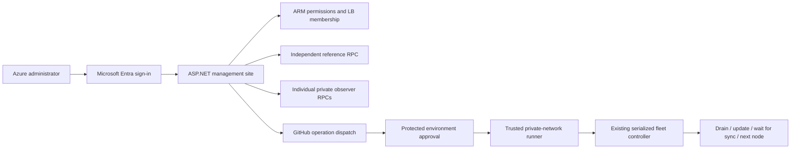

# Observer management website

The .NET 10 management application is orchestrated by a separate Aspire 13.6 AppHost. It does not include an observer resource: starting Aspire or releasing this website cannot provision an observer, mount storage, or change an observer image. No live Azure resources were changed while implementing this application.

## Architecture



The site queries the configured load balancer's `observers` pool and resolves its NIC references to VM identities and private addresses. It rejects foreign resource groups and unsupported IP-only backend pools rather than producing incomplete inventory. A reference RPC failure fails the overall status request. Per-node failures show unreachable; stopped/deallocated VMs show offline without being started. Sync requires matching chain IDs, an absolute height difference of at most three blocks, and matching hashes at the common height. This is a fresh observation, not a persistent monitoring service or the Azure load balancer's probe metric.

Microsoft sign-in uses a **single tenant** confidential Entra web application with authorization code + PKCE. Register `https://<management-host>/signin-oidc` as a Web redirect URI. Grant delegated Azure Service Management `user_impersonation` permission and appropriate tenant consent. The site uses the signed-in user's ARM token to query resource-group permissions on every protected request. It requires the configured `Entra__AllowedObjectId` to match the signed-in user, then checks VM write, VM delete and load-balancer write permissions (Owner/Contributor or equivalent custom permissions) at the observer resource-group scope. An Entra directory administrator or Reader alone is insufficient. VM-only role assignments are intentionally insufficient for this fleet-wide console. ARM remains authoritative for inventory access; Azure deny assignments/policies may still prohibit particular operations. Tokens expire after about an hour; sign in again rather than retaining long-lived refresh tokens. HTTPS-only protected cookies, tenant validation and antiforgery validation protect management requests.

## Provisioning without touching existing observers

1. Use a dedicated, unused subnet in the observer VNet, **/27 or larger** and delegated to `Microsoft.App/environments`. Keep the existing observer NSG allowance from that subnet's CIDR to TCP 8545. Do not reuse the VM or API subnet. No public observer RPC ingress is needed.
2. Choose an ACR and a user-assigned managed identity with image pull rights on that registry (`AcrPull` for registry RBAC, or the equivalent repository-reader permission for an ABAC registry). The registry must allow ARM audience tokens for managed identity pull. Grant the identity no observer management permissions. The deployment references both resources without modifying them. [Microsoft setup instructions](https://learn.microsoft.com/azure/container-apps/managed-identity-image-pull).
3. Build and deploy the first image using the commands below. Supply the Entra credentials through the deployment prompts. The management-only template creates a dedicated VNet-integrated Container Apps environment with a Consumption profile and a single management app. It uses HTTPS ingress with application-level Entra authentication. It does not create an App Service plan or deploy observer resources.
4. Create protected GitHub environments `observer-management-adiri`, `observer-management-mainnet`, `observer-operations-adiri`, `observer-operations-mainnet`. Configure **required human reviewers**, prevent self-review where supported, and restrict deployment branches to `main`. Workflow environment references alone do **not** create approval policies. GitHub plan/repository visibility must support those protection rules; do not enable deployment/mutation without them.
5. In each website environment set `AZURE_CLIENT_ID`, `AZURE_TENANT_ID`, `AZURE_SUBSCRIPTION_ID`, `MANAGEMENT_APP_NAME`, `MANAGEMENT_RESOURCE_GROUP`, `OBSERVER_RESOURCE_GROUP`, `OBSERVER_LOAD_BALANCER`, `OBSERVER_REFERENCE_RPC`, `OBSERVER_CHAIN_ID`, `OBSERVER_PUBLIC_LOAD_BALANCER`, and `MANAGEMENT_REGISTRY_NAME`. Configure Azure federated credentials for that GitHub environment. Grant the deployment identity read/update rights on the management Container App, registry metadata read, and push rights to its management image repository. Scope these grants as narrowly as the registry mode allows. It needs no rights to observer VMs or TelExplorer. Set `MANAGEMENT_DEPLOY_ENABLED=true` only after setup. The deployment verifies the target app's `purpose=oprail-observer-management` and matching network tags before updating its configuration.
6. Install a trusted Linux self-hosted runner labeled `observer-operations`, with Azure CLI, Python 3, git, Bash and SSH, private networking, persistent `/var/lib/oprail-observers` and `/etc/oprail-observers`. Use exactly **one controller runner per pool**: the existing controller has a local file lock, not a cross-machine lease. Both lifecycle workflows use the same GitHub concurrency group. Give its managed identity observer lifecycle rights in the specific observer group, and build/pull/role-assignment rights at the existing ACR as required by the controller; do not grant subscription-wide Contributor by default. ACR role assignment provisioning requires additional authorization rights beyond VM Contributor.
7. Use a runner-specific pool profile/SSH key path with a locked-down service key and pre-populated host keys. The checked-in Adiri profile's Mac SSH key path is a local operator default, not a production runner credential. Preserve node inventory and validated release/snapshot manifests in persistent state. For each add slot, prepare `/etc/oprail-observers/<network>/node-<1-99>.env` with unique VM/DNS names, fresh key passphrase, private RPC settings and desired disk configuration. These files are trusted shell configuration, owned by the runner administrator, mode 0600. The browser supplies only the numeric slot. Existing VM names and disks are rejected by the provisioning script.
8. Verify read-only status and an approval-gated canary operation, then explicitly set `Operations__Enabled=true` on that site's app settings. Provisioning defaults it to false. Do not enable the optional hourly snapshot scheduler as a side effect.

**Adiri**: observer group `oprail-observer-adiri`, private LB `adiri-observers`, public LB `adiri-observers-public`, reference `https://rpc.adiri.tel`, chain ID `0x7e1`. Two observers are running; use live checks rather than assuming either is offline. **Mainnet is not configured**: supply real chain ID/reference/LB/profile and independent state/registry/credentials before enabling its site or runner operations. The example profile is not deployable mainnet configuration.

## First Adiri deployment

Run from the repository root. Set `REGISTRY` to the ACR name, `SUBNET_ID` to the full delegated subnet resource ID, and `PULL_IDENTITY_ID` to the full user-assigned identity resource ID. The first command needs ACR build permissions. Use a fresh image tag for each bootstrap build.

```bash
az account set --subscription 8a149d4d-c52a-4432-929e-de754584e269
REGISTRY='<acr-name>'
SUBNET_ID='<management-subnet-resource-id>'
PULL_IDENTITY_ID='<registry-pull-identity-resource-id>'
TAG="bootstrap-$(date -u +%Y%m%d%H%M%S)"
SERVER=$(az acr show -n "$REGISTRY" --query loginServer -o tsv)

az acr build -r "$REGISTRY" --platform linux/amd64 \
  -t "observer-management/adiri:$TAG" src/Observer.Management
```

After the build succeeds, run:

```bash
az deployment group create -g oprail-observer-adiri \
  --name observer-management-aca-adiri --mode Incremental \
  --confirm-with-what-if --template-file infra/management/main.bicep \
  --parameters location=centralus network=adiri \
    loadBalancerName=adiri-observers publicLoadBalancerName=adiri-observers-public referenceRpc=https://rpc.adiri.tel chainId=0x7e1 \
    managementSubnetId="$SUBNET_ID" registryServer="$SERVER" \
    registryPullIdentityId="$PULL_IDENTITY_ID" \
    image="$SERVER/observer-management/adiri:$TAG"
```

The default app name is `oprail-observer-mgmt-adiri`. Enter the tenant ID, sign-in app client ID, client secret value, and your Entra user object ID (`allowedObjectId`) when prompted. The user object ID is not the app registration object ID. The deployment outputs the site URL; register that URL plus `/signin-oidc` in Entra. Keep operations disabled for the first sign-in and status checks. For later enablement, add the Container App secret `github-dispatch-token`, then set `Operations__GitHubToken=secretref:github-dispatch-token` and `Operations__Enabled=true` after completing the runner and approval steps. Use normal CI releases for subsequent app updates; rerunning the bootstrap template reapplies its original settings and disables operations.

Aspire remains the local AppHost. Azure uses the explicit management-only template and a revision update workflow to keep the deployment scope narrow.

## Build and release

`observer-management-site.yml` builds on changes to the website on main and makes the same artifact available to the two protected deployment environments. Reviewers can approve either environment independently. A manual dispatch targets one network. Deploy steps push the tested image to the configured registry and update only the tagged Container App's image digest and network-specific settings in one revision. They never invoke `deploy-azure-vm.sh`, `deploy-pool.py`, or any VM deployment template.

`observer-management-operations.yml` runs only main, after the chosen operations environment approves. GitHub workflow logs, run status, triggering account, requested Entra object ID and the web application's structured logs provide the execution trail. The dashboard links to the workflow history after submission; it does not yet stream job progress. Dispatch failures are not automatically retried because submission may have succeeded upstream.

- **Add** restores the latest complete snapshot pair with the promoted network image and fresh identity. It waits for sync. A prepared slot file is required.
- **Remove** rechecks actual backend membership and controller inventory under lock. The final observer cannot be removed, and another observer must be synced. The selected node's disks are permanently deleted.
- **Build** accepts a full `refs/tags/...` or `refs/heads/...` reference, resolves it to a commit and builds a candidate; it changes no running nodes.
- **Rollout** accepts only an immutable digest matching this network's validated promoted release. After validation, an operator promotes via `fleet.py --config ... --apply promote <digest>` on the trusted runner. The site deliberately does not claim a successful build is validated. Existing migration policy drains the highest ordinal first, updates it, requires consecutive successful sync observations, then advances. Failure leaves that node drained and stops the rollout. Single-node maintenance is disabled by default; add a second synced node first.

## Local development and verification

Configure `Parameters:entra-tenant-id`, `Parameters:entra-client-id`, `Parameters:entra-owner-object-id`, and secret `Parameters:entra-client-secret` on the management AppHost using .NET user secrets. Register its HTTPS callback URL in Entra. Run:

```sh
dotnet run --project infra/aspire/Observer.Management.AppHost
```

Local status requires Azure admin rights **and a private route** to node RPCs (VPN or a host inside the VNet). There is no authentication bypass or synthetic production status. The existing observer AppHost remains separate.

```sh
dotnet build infra/aspire/Observer.Management.AppHost
dotnet run --project tests/Observer.Management.PolicyTests
python3 -B -m unittest discover -s tests
```

Before live enablement, verify Microsoft login, Reader denial, admin access, expired-session behavior, CSRF rejection, stopped-node status, a reference-chain mismatch, and private RPC reachability. Then run an approved canary add/build/rollout/remove against disposable nodes. Unit tests and a successful compile cannot validate Entra consent, GitHub protection rules, actual Azure routing or live rollout behavior.

The current Aspire 13.6 dependency graph reports NU1902 for its transitive MessagePack 2.5.302 package and ASPIRE010 for the optional CLI bundle. These are local AppHost warnings; the published web application does not reference Aspire/MessagePack. Review the Aspire dependency advisory before exposing an Aspire dashboard beyond local development.

API implementation references: [resource-group effective permissions](https://learn.microsoft.com/en-us/rest/api/authorization/permissions/list-for-resource-group?view=rest-authorization-2022-04-01), [OpenID Connect in ASP.NET Core](https://learn.microsoft.com/en-us/aspnet/core/security/authentication/configure-oidc-web-authentication).

## Admin panel operations and history

### Adiri runner and approval setup

The dedicated `adiri-observer-runner` uses a B2s VM with a 32 GiB Standard SSD
OS disk, managed identity and a public IP for outbound access. Its dedicated
NSG denies all inbound traffic. Use Azure Run Command for administration.
`infra/management/runner.bicep` and `runner-bootstrap.sh` provision only this
controller; they do not redeploy observers. Persistent fleet state lives in
`/var/lib/oprail-observers/adiri/adiri`; the protected profile and template live
in `/etc/oprail-observers/adiri`. The profile uses the runner's own SSH key,
not an operator's laptop key. Do not start a second controller against this pool.

Both Adiri GitHub environments require reviewer `ArieJones` and the exact main
branch. Self-review remains allowed because this is a single-administrator
setup; the explicit deployment approval is still required. Website CI uses a
separate federated identity with app-scoped Contributor and registry push/read
rights, with no observer VM rights. Registry legacy RBAC grants repository-wide
push on that registry; changing its permission mode is a separate migration.

The operations workflow also supports `check` with argument `cluster`: it
validates inventory, VM tags, SSH and sync without changing nodes. Run and
approve this before enabling panel controls. It uses the runner's protected
profile rather than the laptop defaults committed under `infra/pool`.

To connect panel history, create a fine-grained GitHub token under
<https://github.com/settings/personal-access-tokens/new> with resource owner
`SkunkWyrx`, only repository `telcoin-network-cli`, and repository **Actions:
Read and write** (Metadata read is automatic). Choose an expiry and arrange
rotation. If organization approval is required, complete it first. Run locally:

```bash
python3 scripts/connect-management-github.py
```

Enter the token at the hidden terminal prompt, never in chat or a tracked file.
The script stores it as an Azure Container App secret and explicitly leaves
operations disabled. After the approved read-only runner check succeeds and
history is visible, enable controls explicitly. Scheduled snapshots remain
disabled until the manual capture/restore/remove acceptance tests pass.

The site now shows private pool membership and public pool admission separately,
checks sync against the independent reference, and queries each proxy's
`19091/readyz` to distinguish a synced-but-drained node from one ready for
traffic. That probe is readiness, not the authoritative Azure probe metric.
Permit private management subnet access to 8545 and 19091 if your NSG rules
override the normal VNet allowance.

Operation history polls GitHub every 15 seconds and shows queued/waiting,
running workflow step, and success/failure. Detailed per-node progress is
in the linked run log. Health refreshes every 30 seconds while the tab is
visible. The browser never receives the GitHub dispatch token or SSH keys.
The history API uses the most recent 50 workflow runs, displaying up to 15
for the selected network.

Every submitted request gets an ID. The trusted runner stores a record in
persistent state and refuses to execute the same ID twice. A lost connection
or a cancelled run may leave a running record; inspect its Azure result before
submitting a new request. GitHub concurrency and the controller lock serialize
the pool. Do not run multiple runner machines against the same local state.

`upgrade-tag` accepts an exact version tag, builds a pinned candidate,
reconciles actual private LB membership with controller inventory, upgrades
one node at a time, waits for consecutive fresh sync samples, and promotes
only after the entire rollout succeeds. An Adiri tag must end in `-adiri`.
Never use the old tag just to test the button on the live pool: the current
checkpoint-recovery candidate has changes beyond v0.16.0-adiri.

Add supports either pre-provisioned slot files or a protected network template
at `/etc/oprail-observers/adiri/template.env`. The template provides the runner's
SSH key paths and SSH CIDR, VM size/zone/storage settings, and RPC namespace
settings. The controller generates unique node/DNS names and a fresh passphrase
in private persistent state; no per-node key must be entered in the browser.
The current template prefixes are `telcoin-observer-vm-` and
`adiri-oprail-observer-`. Mainnet needs explicit network-specific configuration.
After private sync, the existing proxy/certificate provisioning must pass
before public admission. Removal refuses the certificate issuer until that
role is migrated and always requires another synced node.

The management runner must have a private route and working SSH to both
observers, persistent copies of the current `nodes.json`, snapshot and release
manifests, and the protected template. The current operator's laptop state is
not automatically transferred to a future runner. Before launch, deliberately
promote the live-tested checkpoint digest as the default for add operations;
the old latest-release pointer must not silently send new nodes back to the
unpatched release.

Deployment acceptance remains separate from local tests: configure the Entra
registration/secret and the owner's object ID, deploy the Container App using
the dedicated management subnet, install the trusted runner with scoped
managed identity, set up required GitHub environment reviewers, and test a
read-only login before enabling mutations. Do not grant the website itself
VM write permissions. Website CI updates only the management Container App.
